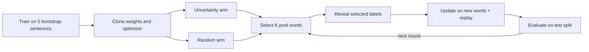

# uq-pet-token: token-level active learning for NER

Does a token classifier learn faster when each online update uses its most uncertain
unlabelled words instead of the same number of random words? This is the token-level
counterpart of [DogRog/uq-pet](https://github.com/DogRog/uq-pet), which selects whole
sentences by LLM uncertainty and fine-tunes on them.

Experiments run on [PET](https://github.com/patriziobellan86/PETv1.1) by default
(business-process descriptions, 7 process entity types, 15 BIO tags),
[Quishpi](https://github.com/PADS-UPC/atdp-extractor/tree/bpm2020/input) (Action,
Entity, and Condition spans), and
[MedicalProcessInstruks](https://huggingface.co/datasets/dagrat/MedicalProcessInstruks)
(English clinical guidelines, 19 process entity types). The supplied configurations cover
DistilBERT, BERT, RoBERTa, DeBERTa-v3, and ModernBERT. The LLM baseline is the separate
uv project in [`llm-annotation-eval/`](llm-annotation-eval/).

Terms are defined in [GLOSSARY.md](GLOSSARY.md), design decisions and their reasons in
[docs/adr/](docs/adr/), and contributor and agent conventions in [AGENTS.md](AGENTS.md).

## Quick start

Use Python 3.12 or newer and `uv`:

```bash
uv sync
uv run marimo edit notebooks/bert_token_uq.py
```

Choose settings and press **Run experiment**. Real runs download the dataset and model
weights when needed; `marimo run` gives the app view without the code editor. Running
the notebook as a plain script only renders synthetic display data, unless one JSON
object starts a real run without the UI:

```bash
uv run notebooks/bert_token_uq.py --config-json \
  '{"checkpoint":"microsoft/deberta-v3-base","model_seeds":[0],"update_passes":2,"learning_rate":0.00003}'
```

Defaults live in `src/uq_pet/config.py` (PET, `distilbert-base-cased`, model seeds
0–4, entropy, 32 new words per round, a 100% budget, learning rate `5e-5`). A run writes
`config.json`, `results.csv`, `selections.json`, and `predictions.npz` under
`results/bert_token_uq_<timestamp>/`.

MedicalProcessInstruks is gated: accept its conditions on the dataset page and run
`uv run hf auth login` once. To log to Weights & Biases, put `WANDB_API_KEY` in the
environment or in a `.env` file at the project root.

| Task | Entry point |
| --- | --- |
| Run one UQ metric against random | `notebooks/bert_token_uq.py` |
| Run every paper experiment, one parallel chain per dataset | `scripts/run_all_experiments.sh` |
| Tune random acquisition on a validation holdout | `scripts/tune_random_all_models.sh` |
| Compare all UQ metrics, top-K and with Gumbel noise, at the validation winners | `scripts/run_best_uq_all_models.sh` |
| Compare word form caps with the winners | `scripts/run_stochastic_uq_all_models.sh` |
| Tune and train the fully supervised upper bound | `scripts/run_supervised_all_models.sh` |
| Run the appendix's test-tuned random oracle sweeps | `scripts/run_oracle_random_all_models.sh` |
| Sample hyperparameters and compare UQ against random | `scripts/run_random_search_all_models.sh` |
| Compare the paper rerun across datasets and models | `notebooks/paper_results.py` |
| Save model snapshots and score a pool document for the suggestion heatmap | `scripts/suggestion_heatmap.py` |
| Check preprocessing against the raw files and compare lexical diversity | `notebooks/preprocessing_checks.py` |

## Protocol



### Data splits

Each dataset is split 80/20 into a train split and a test split with a fixed RNG seed;
five train-split sentences become the bootstrap sentences and the rest form the pool
([ADR 0005](docs/adr/0005-data-splits-are-pinned.md),
[ADR 0008](docs/adr/0008-new-datasets-are-split-like-pet.md)):

| Dataset | Bootstrap | Pool | Test | BIO tags |
| --- | --- | --- | --- | --- |
| PET | 5 | 328 | 84 | 15 |
| Quishpi | 5 | 155 | 41 | 7 |
| MedicalProcessInstruks | 5 | 255 | 65 | 39 |

- **Quishpi** uses the judge annotations from `PADS-UPC/atdp-extractor` at a pinned
  commit: 18 process descriptions whose brat spans are cut into words and sentences in
  `data_prep.brat_sentences`. 13 of the 18 texts are also PET documents, so Quishpi is a
  coarser, sparser labelling of largely the same text rather than a new domain.
- **MedicalProcessInstruks** is loaded at a pinned revision. Its released train and test
  files are joined, because the released test file is one guideline of 28 sentences. The
  release names no tags, so each type is tagged by its begin id (`B-T03`/`I-T03` …);
  notebooks show the authors' names (`MEDICAL_TYPE_NAMES` in `data_prep`), and saved runs
  keep the id tags.

`dataset_percent` keeps that percentage of the pool. Smaller pools are nested prefixes of
one seeded shuffle; the bootstrap and test sentences do not change.

### One run

For every model seed:

1. Fine-tune a fresh token classifier on the five bootstrap sentences.
2. Clone the exact fitted weights and optimizer state into uncertainty and random arms.
3. Evaluate both arms before acquisition (round 0).
4. At each round, acquire `K` previously unseen pool words, or the remaining budget
   in the final round:
   - uncertainty selects the largest score from the configured UQ metric, optionally
     after Gumbel noise and a word form cap (see below);
   - random draws uniformly from its remaining candidates.
5. Reveal only the selected labels.
6. Continue each arm from its current weights and optimizer state using the new
   word-centred items plus limited replay.
7. Evaluate on the test split and repeat.

Three optional settings change training, all off by default
([ADR 0012](docs/adr/0012-bootstrap-has-its-own-learning-rate-and-arms-report-averaged-models.md)):
`bootstrap_learning_rate` gives step 1 its own peak rate, warmed up over the first tenth
of the bootstrap's updates and decayed to zero, while the rounds keep the constant
`learning_rate`; `weight_averaging` scores, evaluates, and snapshots each arm's averaged
model, which moves halfway to the live weights after every round; and `max_grad_norm`
clips every update, the supervised baseline's included.

The full sentence remains model input, but each online training item labels exactly
one word. Only its first subword contributes to loss; every other position is `-100`.
By default, each round replays up to one older labelled word per new word, including
words from the bootstrap sentences; replay scales down with a smaller final round. A 100%
budget acquires every scoreable word; lower budgets round down to a whole number of words.

### Evaluation

Every evaluation scores entities two ways:

- **Exact match** (`entity_f1`, `entity_macro_f1`, `entity_precision`,
  `entity_recall`): seqeval's default mode, so an entity counts only if its type and
  both boundaries match a gold entity. This is the tuning objective and the headline gap.
- **Partial match** (`entity_partial_*`): an entity counts if a gold entity of the same
  type shares at least one word with it; within each sentence, predicted entities match
  in order and each gold entity matches at most once, as in `llm-annotation-eval/`.
  Reported only ([ADR 0010](docs/adr/0010-partial-entity-match-is-reported-not-tuned.md)).

`predictions.npz` keeps the predicted and gold tags behind each `results.csv` row, so
metrics can be recomputed without retraining:

```python
from uq_pet.active_learning import read_predictions, rescore_run

gold, predictions = read_predictions(run_dir)  # predictions[i] is results.csv row i
metrics = rescore_run(run_dir)  # evaluate_predictions for every row, in order
```

### UQ metrics

All three metrics use the first subword's class probabilities, and larger values mean
more uncertain:

- `entropy`: normalized predictive entropy.
- `least_confidence`: one minus the largest class probability.
- `margin`: one minus the gap between the two largest class probabilities.

### Gumbel noise and the word form cap

Two optional settings change only the uncertainty arm; random's draws stay identical
([ADR 0009](docs/adr/0009-stochastic-and-capped-uncertainty-acquisition.md)).

- `gumbel_noise: true` adds Gumbel(0, 1) noise to `log(score)` and takes the top K,
  sampling K words without replacement in proportion to their scores. The noisy log
  score is saved as `acquisition_score` beside `uq_score`.
- `max_per_word_form: N` selects at most N words with the same lowercased form per
  round. When too few forms remain, the round is filled from the skipped words in rank
  order.

### Invariants

- The test split is evaluation-only.
- Pool inputs passed to uncertainty scoring contain no labels.
- A label is read from the private pool lookup only after its word is selected.
- Acquisition is without replacement and counts newly labelled words.
- First subwords are used consistently for scoring, online loss, and evaluation.
- Continuation subwords, padding, and special tokens are ignored.
- Truncated pool words are not selectable; truncated test words are an error.
- A word is truncated if any of its subwords are missing, including at the left boundary.
- Both arms begin from the same fitted state and receive the same update budget; their
  averaged models, when on, start from that state too.
- The uncertainty and random arms keep separate weights and optimizer histories.
- Selection, Gumbel noise, and replay use deterministic local random generators.
- Training derives an RNG seed for each arm and round, used for dropout as well as
  shuffling, and restores the surrounding RNG states even if an update fails.

## Workflow

The main study tunes the random baseline on a validation holdout, freezes each model's
winner, and compares all UQ metrics against random on the test split. The supervised
baseline adds an upper bound. `scripts/run_all_experiments.sh` runs steps 1–3 and the
random sweep as one chain per dataset, in parallel on the same GPU; the oracle appendix
and word form caps are not included:

```bash
bash scripts/run_all_experiments.sh --dry-run
bash scripts/run_all_experiments.sh
```

`SEED_WORKERS` sets concurrent seeds per chain (default 2, sized for a 40 GB GPU). Each
chain logs to `logs/run_all/<dataset>.log`, and a failed chain does not stop the others.
Run it inside `tmux` or `nohup` on a remote machine.

All launchers take `--dry-run`, which prints the plan without loading data or models;
`MODELS` picks checkpoints (see `scripts/models.sh`), and all but the oracle take
`DATASETS`, e.g. `DATASETS="quishpi medical"`. Rerunning any launcher or CLI resumes it
(see [Resuming](#resuming)).

### 1. Tune the random baseline

```bash
bash scripts/tune_random_all_models.sh
uv run scripts/run_search.py --config configs/pet/tune_random/distilbert.json  # one model
```

`--mode tune-random` trains **random selection only** and never reads the test split. It
holds out 66 pool sentences on PET (31 on Quishpi, 51 on MedicalProcessInstruks) as the
validation holdout, which cannot be acquired or replayed. Each
`configs/<dataset>/tune_random/<model>.json` samples 100 configurations (see
[Search space](#search-space)) with five model seeds, and the winner maximizes the
model-seed mean of normalized validation entity-F1 AUC against acquired-pool percentage,
including round 0 (`objective: random_validation_final_entity_f1` uses the endpoint
instead; ties go to the lowest config ID).

Outputs go to `results/random_baseline_search/<sweep-name>/`: `plan.json`, `split.json`,
per-trial `tuning/<config-id>/`, the winning `best_config.json` and `selection.json`, and
`summary.json`. The winner is the best sampled configuration on this holdout, not a
global optimum; keep it frozen when assessing UQ methods.

### 2. Compare UQ metrics at the winners

```bash
bash scripts/run_best_uq_all_models.sh
uv run scripts/run_uq_metrics.py --config configs/pet/best_uq/bert_base.json  # one config
```

The launcher freezes each completed tuning winner into `configs/<dataset>/best_uq/` with
`scripts/freeze_best_uq.py` (rewritten whenever the winner changes; commit them, see
[configs/README.md](configs/README.md)), then compares entropy, least confidence, and
margin against random, once top-K and once with Gumbel noise. Bootstrap training and the
matched random baseline are shared across metrics. Results go to
`results/best_uq/<checkpoint>[-<dataset>]-best-uq/`, per metric under
`runs/config_0000/<metric>/`.

`run_uq_metrics.py` also takes `--uq-metrics`, `--gumbel-noise`, `--max-per-word-form N`
(adding `-gumbel` or `-capN` to the result group), `--seed-workers`, `--config-json`, and
`--sweeps-dir`. `scripts/run_stochastic_uq_all_models.sh` runs caps of 1 and 2, and
Gumbel noise with a cap of 1, under `results/best_uq_stochastic/`; no notebook analyzes
the cap runs.

### 3. Supervised upper bound

```bash
bash scripts/run_supervised_all_models.sh
uv run scripts/run_supervised.py --config configs/pet/supervised/distilbert.json  # one model
```

Following Vacareanu et al. (LREC-COLING 2024), a fresh pretrained model is trained on
fully labelled sentences for a fixed number of epochs (default 20, no early stopping),
supervising first subwords only
([ADR 0006](docs/adr/0006-supervised-baseline-is-a-comparable-upper-bound.md)).

1. **Tune on validation.** 30 sampled configurations (log-uniform learning rate in
   [1e-5, 5e-4], batch size 8/16/32, weight decay 0/0.01) train on the bootstrap
   sentences plus the tuning pool and are scored on the same validation holdout as step 1.
   The highest seed-mean validation entity F1 wins.
2. **Test runs.** The winner is retrained for each model seed on the bootstrap sentences
   plus `sentence_percents` of the full pool (default `[100]`; e.g. `[10, 50, 100]` takes
   nested prefixes of a label-free sentence order) and evaluated once on the test split.

`--stage tune` stops after freezing the winner, and `--stage test` requires it. Outputs go
to `results/supervised/<sweep-name>/`, with test rows under `test/pool_<percent>pct/`.

### 4. Analyze saved results

```bash
uv run marimo edit notebooks/paper_results.py
```

The notebook reads saved files and trains nothing. Its chapters cover progress and the
tuning winners, the headline gap, learning curves, label efficiency, the supervised
ceiling, LLM annotation, top-K against Gumbel noise, UQ metrics, the random sweep, a
test-split entity viewer, and the suggestion heatmap.

The suggestion heatmap needs a run that saves model snapshots (by default DistilBERT with
margin on PET, model seed 0, at the validation winner):

```bash
uv run scripts/suggestion_heatmap.py train --rounds 0 10 25 50
uv run scripts/suggestion_heatmap.py score results/suggestion_heatmap/distilbert-base-cased-margin-seed0 --round 10
```

`score` loads one round's snapshot, scores every word of a pool document without labels,
checks the next round's suggestions against the saved run, and writes
`heatmap_round_<round>.json`. Two consecutive scored rounds (say `--rounds 10 11`) also
draw one turn of the active learning loop.

### Appendix: test-tuned random oracle

```bash
bash scripts/run_oracle_random_all_models.sh
```

A PET-only sensitivity check: does UQ still win when the random arm gets the sampled
hyperparameters that score best on the test split
([ADR 0007](docs/adr/0007-random-is-tuned-on-validation-and-test-tuned-oracle-is-appendix-only.md),
[configs/pet/oracle_random/README.md](configs/pet/oracle_random/README.md))? Stage 1 is a
`tune-random` sweep with `"tuning_split": "test"`; stage 2 runs all three UQ metrics at its
winner. Everything stays under `results/oracle_random/` and is never copied into
`configs/pet/best_uq/`. All five checkpoints take about 28 hours. The paper rerun leaves
the oracle out, and no notebook analyzes it.

### Exploratory random sweep

```bash
bash scripts/run_random_search_all_models.sh
uv run scripts/run_search.py --config configs/pet/random_search/distilbert.json  # one model
```

In its default `--mode compare`, `run_search.py` samples a fixed plan (30 configurations
× 3 UQ metrics = 90 paired comparisons per model) and evaluates each against a matched
random arm on the **test** split. There is no validation holdout or selection; treat it
as exploratory. `num_configs` is the total fixed budget, and the plan is saved before any
training, so scores never change it. Outputs go to `results/random_search/<sweep-name>/`;
`summary.json` gives per-metric mean test F1 gap AUC, final gap, and wins, ties, and
losses.

### Training-recipe pilot

```bash
bash scripts/run_pilot.sh
uv run scripts/pilot_report.py
```

Before the next rerun, the pilot decides whether to adopt the training settings of
[ADR 0012](docs/adr/0012-bootstrap-has-its-own-learning-rate-and-arms-report-averaged-models.md).
It tunes random selection on the validation holdout again for PET and Quishpi with BERT
and ModernBERT, over the first 30 configurations of each tuning sweep, and compares
each finished configuration with its constant-rate trial. The criteria were fixed
beforehand in [configs/README.md](configs/README.md#training-recipe-pilot-in-pilot);
the report prints them and, once every run is done, the verdict.

## Reference

### Search space

Random-baseline tuning and the random sweep sample the same ranges; the 72 categorical
combinations can repeat with different learning rates.

| Setting | Values |
| --- | --- |
| `k` | 32, 64 |
| `bootstrap_epochs` | 10 |
| `update_passes` | 1, 2, 4 |
| `learning_rate` | Log-uniform from 0.00001 to 0.0005 |
| `batch_size` | 32, 64 |
| `replay_ratio` | 0, 1, 2 |
| `weight_decay` | 0, 0.01 |

With `tune_bootstrap_learning_rate: true`, each configuration also samples
`bootstrap_learning_rate` over the learning-rate range, from a separate random stream, so
the other settings match the same sampler seed's sweep without it.

### Resuming

Rerunning the same command resumes it: completed outputs are reused and unfinished
configurations restart from bootstrap (no model checkpoints are saved). Only
`seed_workers` and W&B settings may change; any other scientific setting needs a new
sweep name. Run one process per sweep.

### Concurrency and precision

`seed_workers` (notebook: **Concurrent seeds**) trains seeds in separate spawned
processes on one device; saved rows keep seed order whatever the concurrency. Start with
two and increase while throughput and GPU memory allow. `score_batch_size` (default 256
sentences) sets the inference batch for pool scoring and evaluation only.

`precision: "auto"` uses native BF16 autocasting on supported CUDA GPUs and FP32
elsewhere; parameters, optimizer state, and softmax stay FP32. `"fp32"` forces full
precision and `"bf16"` fails early without native support. A sweep locks its
`effective_precision`, so compare precisions under separate sweep names.

### Weights & Biases

Set `"wandb_enabled": true` and `"wandb_project"` to log. Online logging validates
`WANDB_API_KEY` before training; `WANDB_MODE=offline` needs no credentials. Comparison
runs log one W&B run per configuration, UQ metric, and seed. Random tuning and
supervised tuning also publish a W&B sweep with one summary run per completed
configuration and a saved parallel-coordinates chart; IDs are kept in
`wandb_sweeps.json`. Publish a finished search without training:

```bash
uv run scripts/run_search.py --config configs/pet/tune_random/distilbert.json --publish-wandb-only
```

## Development

The checks are listed in [AGENTS.md](AGENTS.md#commands), along with the module
boundaries under `src/uq_pet/`. Tests in `tests/` run offline. Configs are in
`configs/<dataset>/<stage>/<model>.json`, one stage per workflow step above; notebook
helpers are in `notebooks/analysis/`.

The marimo skills from [marimo-team/skills](https://github.com/marimo-team/skills) and a
selection from [mattpocock/skills](https://github.com/mattpocock/skills) are installed
under `.claude/skills/` with the [Vercel skills CLI](https://github.com/vercel-labs/skills);
`skills-lock.json` records their sources. Both are committed so local edits are
versioned, and `npx skills update --project --yes` overwrites those edits, so review its
diff before committing.
